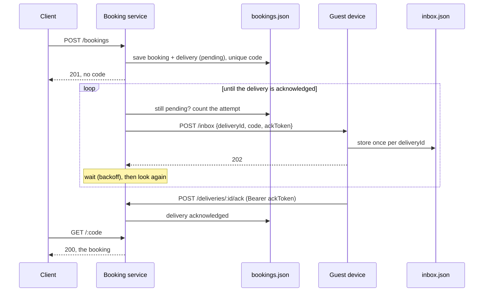
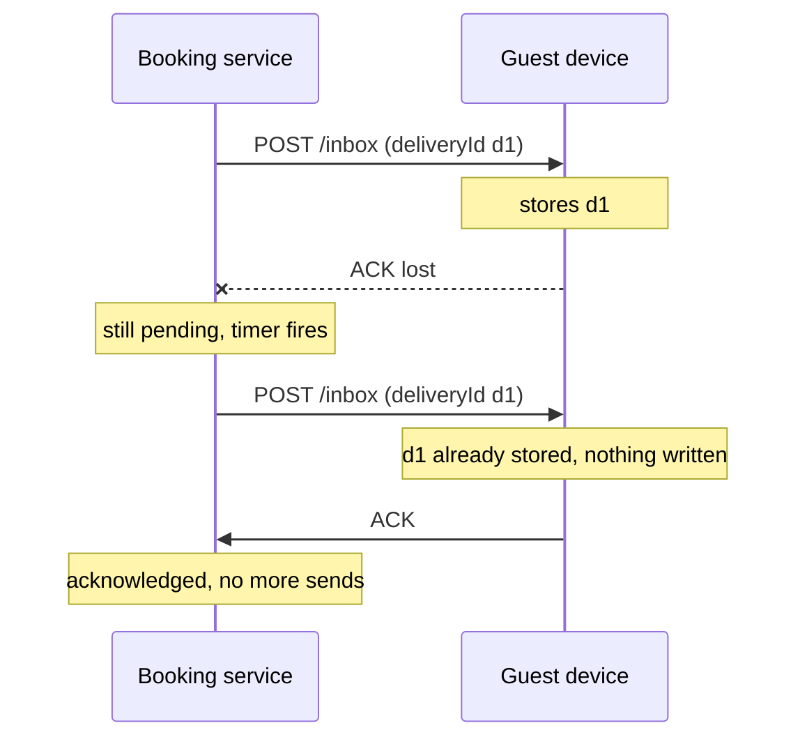

# Design

## One booking, from request to acknowledgement

A delivery has two states, `pending` and `acknowledged`. Only the acknowledgement endpoint moves it, and it never moves back.

## A lost acknowledgement

The sender cannot tell "my message was lost" from "the acknowledgement was lost". So it must be able to send again, and the receiver must make that harmless.

Two sends, one confirmation at the guest.

## What happens when something fails

| Failure                                            | State left behind                        | What happens next                                                    | Test                                                       |
| -------------------------------------------------- | ---------------------------------------- | -------------------------------------------------------------------- | ---------------------------------------------------------- |
| Guest offline                                      | Delivery pending, attempts counted       | Sent again when the timer fires; arrives once when the guest returns | `offline then online`                                      |
| Acknowledgement lost                               | Guest has the entry, server says pending | Sent again; the guest recognises the id and acknowledges again       | `lost ACK`                                                 |
| Booking service restarts before any send succeeded | Pending on disk, timers gone             | On start, every pending delivery is resumed from the file            | `server restart before first send`                         |
| Booking service restarts after the guest stored it | Pending on disk, guest has the entry     | Sent again after the restart; the guest still has one entry          | `server restart after guest receipt`                       |
| Guest restarts                                     | Entry in the guest's file                | The guest still recognises the delivery                              | `guest restart`                                            |
| Disk write fails while creating a booking          | Nothing saved                            | 503; the caller can repeat the request safely                        | `answers 503 PERSISTENCE_UNAVAILABLE…`                     |
| State file damaged                                 | File untouched                           | The service refuses to start                                         | `exits non-zero and leaves a corrupt state file untouched` |

The first five are in `tests/e2e/scenarios.test.ts`, with both real services running.

## Decisions

**Send again, and let the receiver ignore repeats.** "Keep trying until acknowledged" and "never receive it twice" cannot both hold on the wire. They can both hold at the guest: every attempt carries the same `deliveryId`, and the guest stores once per id. Trade-off: the guest must keep the ids it has seen.

**Uniqueness is a check inside the save, not a property of randomness.** A random 5-character code repeats sooner than intuition suggests. The code is drawn, checked against saved bookings and saved, all in one store update, and updates run one at a time. Trade-off: the check scans the bookings; a database index would replace it.

**The booking and its pending delivery are one record.** They are written together, so there is never a booking whose confirmation nobody intends to send. This is the outbox pattern in its smallest form.

**A file, though memory was allowed.** So that a pending confirmation survives a restart. Writes go to a temporary file that is renamed into place, so a crash cannot leave half a file. Trade-off: the whole file is rewritten on each change.

**One timer per pending delivery, not a polling loop.** The brief asks that the server keeps trying; it does not ask for a scheduler. Each attempt re-reads the saved status, so a timer is only a reminder and losing every timer in a crash loses nothing. Trade-off: backoff restarts after a process restart, and nothing caps simultaneous sends. An earlier version polled a saved retry schedule; it was more machinery than the problem needed.

**Only the acknowledgement ends a delivery.** A 2xx from the guest means the request arrived, not that the confirmation is stored. The guest acknowledges after it has saved the entry, with a token that came with the confirmation, compared in constant time.

**A repeated request creates nothing.** `reservationId` identifies the booking, so a client whose response was lost can send the same request again and get the same booking back. No extra idempotency header is needed.

**The code never leaves in the POST response, or in a log.** Response bodies pass through a schema that drops undeclared fields, and per-request logging is off because the URL of a lookup is a code. A test searches the whole log of a running service for the code, the token and the guest's address.

**Libraries for everything that is not the problem.** Atomic file writes, the mutex, code generation, configuration, error bodies, shutdown and API docs each come from a small known package. What is written by hand is the part being evaluated: the uniqueness rule, the retry, and the receiver's dedupe.

**A simulator for the guest's device.** The brief asks for the channel to be simulated and for the device to acknowledge, and sometimes not. A separate small service can go offline, lose an acknowledgement and be restarted independently, which is what lets the failure cases be shown and tested.
